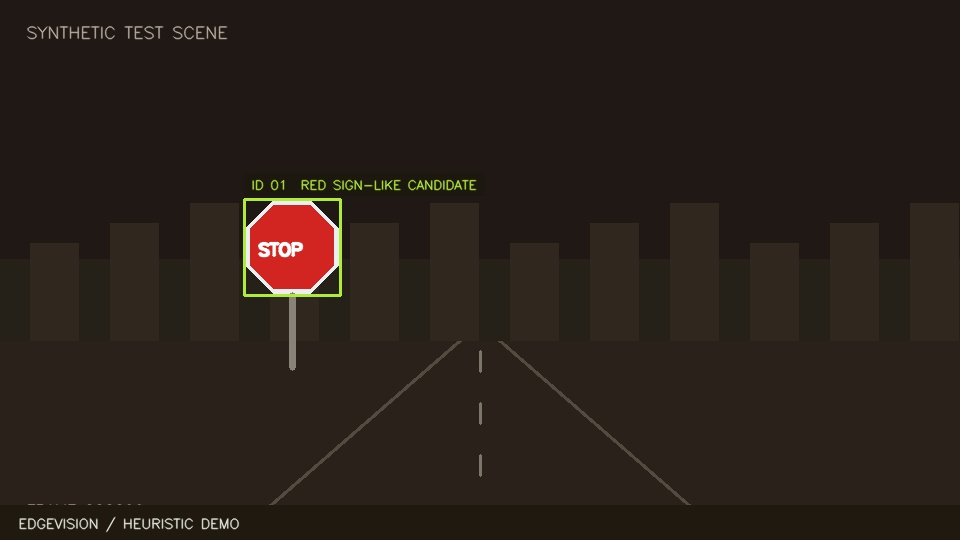

# EdgeVision

**Local-first visual perception with uncertainty-aware alerts, temporal verification, and a real-time edge monitoring console.**

[](https://github.com/Alita41/edgevision/actions/workflows/ci.yml)


EdgeVision is an end-to-end engineering prototype for **observing, tracking, qualifying, and logging sign-like objects on-device**. Its architecture couples lightweight OpenCV region proposals with an **optional TensorFlow Lite traffic-sign classifier**, temporal identity tracking, confidence/margin-based abstention, bounded video backpressure, SQLite event provenance, and a responsive real-time dashboard.

The system has two honest modes:

- **Heuristic demo (runs immediately):** processes a live synthetic scene or camera/video, finds red/blue sign-shaped regions, tracks candidates, and logs observations. It **does not** identify specific traffic-sign classes or supply model accuracy figures.
- **Trained TFLite inference:** with your own trained model and labels, applies neural sign-crop classification, uncertainty gating, temporal confirmation, and typed event logging.

<details><summary><strong>View the deterministic synthetic-frame preview</strong></summary>



*Rendered from a generated test scene. It is not evidence of performance on roads or real imagery.*
</details>

## Why it's interesting

| Engineering problem | Implementation |
|---|---|
| **Weak one-frame detections** | Temporal consensus over tracked objects, configurable minimum hits |
| **Uncertain neural predictions** | Confidence and top-two margin gates, explicit abstention |
| **Camera lag under CPU pressure** | Decoupled capture/inference and bounded, drop-oldest queue |
| **Unverifiable alerts** | Metadata event journal with track ID, timestamps, model fingerprint, box, severity |
| **Model/edge deployment friction** | TensorFlow training, FP32/INT8 TFLite export, Pi guide, backend-agnostic inference |
| **Demo-only accuracy claims** | Separate crop-classification metrics, scene-level IoU metrics, hardware FPS harness |
| **Operator visibility** | FastAPI monitoring dashboard, MJPEG, telemetry, events and live runtime controls |

## Quick start — no neural weights required

Requirements: Python 3.10+.

```bash
python -m venv .venv
source .venv/bin/activate
python -m pip install -e '.[test]'
python -m edgevision.cli serve --source synthetic
```

Open **http://127.0.0.1:8080**. The dashboard displays a deliberately synthetic moving scene, tracking overlays, events, actual measured processing time, dropped-frame count, and source/model status.

For an actual camera or recorded clip:

```bash
python -m edgevision.cli serve --source camera:0
python -m edgevision.cli serve --source /path/to/video.mp4
```

**Privacy note:** Camera frames stay in memory and the event database stores only structured metadata. Bind to loopback unless you add authentication and transport security; this application is not built to be exposed publicly as-is.

### Containerized demo

```bash
docker compose up --build
```

Compose maps only `127.0.0.1:8080` and retains events in a named local volume.

## Use a trained traffic-sign model

The optional supervised training pipeline expects **licensed, user-provided GTSRB class folders** (0 to 42) containing traffic-sign crop images. Datasets and trained weights are deliberately not bundled.

```bash
pip install -e '.[train]'
python scripts/train_gtsrb.py --dataset data/GTSRB/Train \
  --test-csv data/GTSRB/Test.csv --test-root data/GTSRB \
  --epochs 15 --quantize --out-dir runs/gtsrb
```

This trains a small depthwise-separable CNN; reports held-out classification metrics (accuracy, macro F1, confusion matrix, and calibration ECE); and exports a float32 TFLite model plus an optional int8 model using representative images. Passing an official test CSV produces separately labeled held-out test metrics; otherwise the script reports internal validation metrics with that distinction explicit.

```bash
python -m edgevision.cli serve --source camera:0 \
  --model runs/gtsrb/edgevision-int8.tflite \
  --labels runs/gtsrb/labels.json
```

The red/blue contour proposer is only a baseline **region detector**; a classifier trained on cropped signs is *not equivalent* to a fully evaluated road-scene detector. See [model and measurement caveats](docs/evaluation.md).

## Monitoring and API

| Endpoint | Purpose |
|---|---|
| `GET /` | responsive operator console |
| `GET /stream.mjpg` | local MJPEG annotated video |
| `GET /frame.jpg` | most recent annotated frame |
| `GET /api/v1/health` | health, source, mode |
| `GET /api/v1/telemetry` | measured processing latency, FPS, tracks, drops |
| `GET /api/v1/events?limit=30` | retained event journal |
| `GET /api/v1/config` | current thresholds |
| `PATCH /api/v1/config` | change confidence, margin, confirmation hits, alert cooldown |

Only approved runtime tuning keys are accepted; filesystem paths/model changes cannot be issued through the dashboard.

## Tests and reproducible measurements

```bash
pytest -q
python -m edgevision.cli smoke --frames 100
python scripts/benchmark_pipeline.py --frames 300 --out artifacts/reference-pipeline.json
```

The smoke harness exercises actual synthetic-frame perception and event creation. The CPU benchmark measures **real compute time** on generated frames, but never masquerades as trained-model accuracy or Raspberry Pi FPS. Outputs include workload and machine metadata.

For labeled real-scene boxes:

```bash
python scripts/evaluate_annotations.py \
  --ground-truth data/annotations.jsonl \
  --predictions data/predictions.jsonl
```

The evaluator reports per-class and micro precision/recall/F1 at IoU 0.5 plus abstention. For actual edge hardware:

```bash
python scripts/benchmark_device.py --seconds 60 --out artifacts/my-device.json
```

See [evaluation protocol](docs/evaluation.md), [architecture](docs/architecture.md), and [Raspberry Pi deployment](docs/pi-deployment.md).

## Repository layout

```text
edgevision/           source, detector, classifier, tracking, event journal, API
edgevision/web/       live responsive monitoring console
configs/              validated demo config and 43-class GTSRB label mapping
scripts/              training, TFLite export, scene evaluation, benchmarks, replay
assets/               clearly labeled synthetic test imagery
tests/                correctness, uncertainty, persistence, and API tests
docs/                 architecture, measurement methodology, Pi deployment
artifacts/            synthetic reference outputs only
```

## Scope and next steps

The current architecture is an **observational prototype**, not an autonomous-driving or road-safety system. A trained model and independent Raspberry Pi performance results are not bundled; both require dataset- and device-level validation. The next research milestone is to replace contour proposals with a compact learned detector and evaluate held-out night, rain, blur, and occlusion scenes, including false alerts per minute and energy/latency measurements.

## License

MIT
